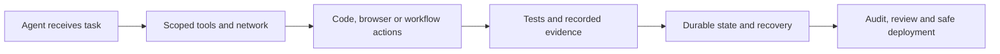

## The day in Software Engineering & Web Development

The strongest signal from the 12–13 October UTC window is that coding agents are acquiring the controls normally associated with production software: restricted network access, scoped permissions, audit trails, failure reporting and recovery semantics. GitHub Agentic Workflows now gives read-only agent runs no network access by default and records richer session provenance, including plugin installations and MCP configuration ([release notes](https://github.com/github/gh-aw/releases/tag/v0.91.10)). Copilot CLI adds hooks scoped to individual custom agents and makes unattended autopilot deny an approval request rather than wait indefinitely for a human who may never see it ([release notes](https://github.com/github/copilot-cli/releases/tag/v1.0.97-0)).

The same direction appears beyond GitHub. Cline moved plugins into its hub process while exposing failed plugins through status and diagnostics ([CLI release](https://github.com/cline/cline/releases/tag/cli-v3.0.71)); OpenHands added browser-session recording and built-in ACP agents ([release notes](https://github.com/OpenHands/OpenHands/releases/tag/v1.27.0)); and Qwen Code improved managed-agent messaging, worktree settlement and test-failure exploration ([nightly release](https://github.com/QwenLM/qwen-code/releases/tag/v0.25.1-nightly.20261012.18f80f5666)). These are not claims that autonomous coding is solved. They are evidence that the surrounding machinery is becoming more inspectable and governable.

## The deeper pattern

The important change is not another promise that an agent can write more code. It is the emergence of a control plane for agentic software work.

A useful way to read today’s releases is as a chain:

At the entry point, GitHub’s workflow change makes least privilege a default for read-only runs. Copilot CLI’s agent-scoped hooks similarly move policy away from a single global configuration towards rules attached to the agent that is actually operating. Next.js is beginning to acknowledge the same reality from the framework side: its canary release gates upgrade reminders behind an `agentUpgrade` setting, enables network access for Codex upgrades, and changes durable-cache hashing while adding a way to disable Turbopack garbage collection ([release notes](https://github.com/vercel/next.js/releases/tag/v16.5.0-canary.9)). Framework upgrades are becoming actions that may be proposed or executed by agents, so their permissions and cache behaviour become part of build safety.

The next layer is observability. Cline’s plugin change removes a runtime prerequisite, but its more consequential feature is that a failed plugin remains visible rather than silently removing tools from the agent. OpenHands’ browser recording addresses a related problem: a successful-looking browser task can be difficult to verify unless the interaction itself is captured. Qwen Code’s test-failure explorer and child-run settlement target the same operational gap from another angle. In multi-step, multi-agent work, “the agent finished” is not a sufficiently useful status. Teams need to know which capabilities loaded, which child tasks settled, which tests failed and what evidence was produced.

Mastra’s release makes the production implication explicit. Durable runs now have ownership claims and storage-level fences, so a recovery worker should not restart a run that is still active elsewhere, and an execution that loses ownership can be prevented from writing stale state ([release notes](https://github.com/mastra-ai/mastra/releases/tag/%40mastra/core%401.76.0)). PostgreSQL working-memory merges are also performed atomically. This addresses a failure mode that ordinary single-process demos rarely expose: after a crash or network partition, two workers can both believe they are responsible and corrupt the conversation, workflow or memory. The release does not prove that every agent system is now safe; it shows that concurrency correctness is becoming a first-class feature rather than an application-specific patch.

The less dramatic releases reinforce the same trend. LangChain’s model profiles expose whether a provider supports mid-conversation changes, giving orchestration code a structured capability signal instead of relying on assumptions ([release notes](https://github.com/langchain-ai/langchain/releases/tag/langchain-openai%3D%3D1.7.1)). pnpm adds registry token creation and revocation, plus a files-based store index for network filesystems where SQLite locking can corrupt shared state ([release notes](https://github.com/pnpm/pnpm/releases/tag/v12.13.0)). Oxlint now reports configuration errors to the language-server client, while its breaking AST comment-storage changes matter to formatter and tooling authors ([release notes](https://github.com/oxc-project/oxc/releases/tag/oxlint_v1.88.0)).

Together, these changes suggest a shift in what “developer productivity” means. The bottleneck is moving from generating a patch to making automated work trustworthy enough to enter a team’s normal engineering system. That requires bounded authority, reproducible context, visible failure, durable state and evidence that can be reviewed.

There is also a practical warning. Several changes are opt-in, canary, nightly or dependent on storage adapters and provider capabilities. Mastra’s fencing is only comprehensive when the relevant stores support it; Next.js’s changes are in a canary release; Qwen Code’s build is explicitly nightly. The direction is clear, but the maturity and interoperability of the resulting control plane remain unproven.

## What to watch next

- Whether GitHub’s no-network default for read-only agent workflows becomes the stable behaviour and whether teams report meaningful compatibility problems with MCP tools or legitimate analysis tasks ([release notes](https://github.com/github/gh-aw/releases/tag/v0.91.10)).

- Whether the agent-aware upgrade and cache changes in Next.js reach a stable release without regressions in automated upgrades, cross-deployment cache reuse or Turbopack development workflows ([release notes](https://github.com/vercel/next.js/releases/tag/v16.5.0-canary.9)).

- Whether agent frameworks begin publishing interoperable evidence and ownership conventions—such as browser recordings, test-failure reports, run fences and capability metadata—rather than implementing isolated, vendor-specific controls ([Mastra](https://github.com/mastra-ai/mastra/releases/tag/%40mastra/core%401.76.0), [OpenHands](https://github.com/OpenHands/OpenHands/releases/tag/v1.27.0), [LangChain](https://github.com/langchain-ai/langchain/releases/tag/langchain-openai%3D%3D1.7.1)).

## Editorial note

The main blind spot is outcome evidence. These are verified release changes, but the supplied material contains little independent evidence about adoption, production incidents or measurable improvements in developer throughput and safety. The edition therefore treats them as signals of engineering direction, not proof that agentic workflows are already reliable at scale.
