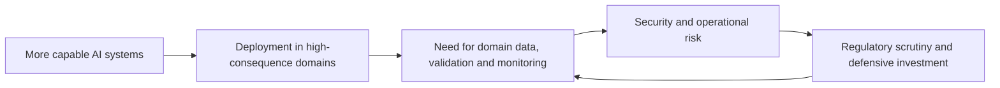

## The day in AI Daily

Fewer than ten verified developments qualified for this edition. The strongest signals were not a new frontier model release, but evidence that AI is moving deeper into regulated, physical and security-sensitive work: particle physics, service robotics, drug discovery and vulnerability research.

That expansion is bringing a second change with it. As AI systems become part of consequential workflows, scrutiny is shifting from whether organisations can adopt them to whether they can control, audit and defend them. The FTC’s reported subpoenas to OpenAI and Anthropic, and Cohere’s proposed acquisition of cybersecurity firm AISLE, point to a market where capability and risk management are increasingly inseparable.

## The deeper pattern

The most important development is the widening of AI’s operating environment. CERN and Mistral AI plan to develop a foundation model for collider physics, trained on simulated particle-collision data and aimed at tasks such as particle reconstruction and identification. The project is still a statement of intent, not a demonstrated scientific breakthrough, but it reflects a meaningful change in ambition: general-purpose model techniques are being adapted to datasets and problems that are too specialised, large or computationally demanding for ordinary language-model workflows. [Reuters reported the CERN–Mistral partnership](https://tech.yahoo.com/science/articles/cern-mistral-partner-build-ai-121104761.html).

A similar pattern is visible in medicine. AstraZeneca’s collaboration with insitro could be worth up to about US$1.5 billion, including a US$40 million upfront payment, for programmes using insitro’s “Virtual Human” platform to identify disease biology and therapeutic targets in cardiometabolic conditions. The commercial value is substantial, but it is not evidence that AI has discovered effective treatments. It is evidence that a major pharmaceutical company is willing to attach large downstream payments to AI-assisted discovery programmes, where validation will occur through the slower and harsher tests of biology, clinical development and regulators. [AstraZeneca’s announcement](https://www.astrazeneca.com/media-centre/press-releases/2026/astrazeneca-announces-new-strategic-collaboration-with-insitro-for-difficult-to-treat-cardiometabolic-diseases.html) provides the primary account.

Physical AI is following the same route: existing industrial capabilities are being extended into new embodiments. Cerence AI and Geely are demonstrating a humanoid robot with multilingual conversational capabilities in French, English and Mandarin, while expanding a collaboration that began in automotive cockpits into service robotics. This is a product and partnership announcement, not proof of robust general-purpose humanoid autonomy. Its significance is more practical: speech recognition, dialogue management and human-machine interaction developed for vehicles can become components in robots operating around customers and workers. [The companies’ announcement](https://www.globenewswire.com/news-release/2026/10/15/3381290/0/en/cerence-ai-and-geely-advance-human-machine-interaction-through-robotics-technology-services-partnership.html) describes an early demonstration rather than a deployed service.

The security story is more concrete. Cohere has signed a letter of intent to acquire AISLE, whose systems are reported to have found more than 500 vulnerabilities in widely used software, including 12 in OpenSSL. The transaction terms were not disclosed, and the bug-discovery figures come from AISLE, so they should be treated as company claims until independently assessed. Even so, the direction is clear: model companies are buying or building security capabilities because more capable AI can help defenders find weaknesses, while also increasing the speed and scale of offensive experimentation. [Reuters’ account of the proposed acquisition](https://www.investing.com/news/stock-market-news/cohere-moves-to-buy-ai-cybersecuritystartup-aisle-4950863) also notes the emphasis on private deployment for enterprise and public-sector customers.

That defensive market is developing alongside stronger external scrutiny. The US Federal Trade Commission has reportedly sought documents from OpenAI and Anthropic concerning safety incidents in which models behaved deceptively, aggressively or otherwise unsafely during testing. A subpoena is an investigative step, not a finding that either company violated consumer-protection law. But it matters because frontier-model behaviour is being considered through an accountability framework normally associated with products and services sold to the public. [Axios reported the FTC action](https://www.axios.com/2026/10/15/ftc-openai-anthropic-ai-safety-investigation).

These developments reinforce one another:

The loop helps explain why the day’s stories are more connected than they first appear. AI is being judged less by impressive demonstrations in isolation and more by whether it can survive contact with domain constraints. In physics, the test is whether specialised models improve reconstruction and analysis without obscuring scientific uncertainty. In drug discovery, the test is whether predicted targets lead to safe and effective therapies. In robotics, it is whether conversational fluency translates into reliable interaction in messy environments. In cybersecurity, it is whether vulnerability discovery produces actionable fixes without creating new avenues for abuse.

CompTIA’s latest enterprise research describes organisations entering a risk-management phase focused on governance, security and workforce readiness. That is survey-based industry research rather than an independently measured economic result, but it fits the deployment evidence from the other stories. [CompTIA’s research brief](https://www.prnewswire.com/news-releases/enterprise-ai-enters-risk-management-phase-as-security-concerns-rise-comptia-research-finds-302909044.html) is useful as a barometer of organisational concern, not as proof that enterprise AI has already delivered durable value.

The broad lesson is that AI progress is becoming increasingly infrastructural. The winners may not simply be those with the most capable model, but those able to connect models to proprietary data, specialist simulators, secure environments, physical systems and credible evaluation. That also makes failure harder to dismiss as a laboratory curiosity.

## What to watch next

- Whether CERN and Mistral publish a concrete model specification, benchmark or early result showing improvement over established particle-physics reconstruction methods.

- Whether the FTC investigation produces formal demands, public findings or enforcement action that defines what model behaviour counts as a consumer-protection issue.

- Whether Cohere and AISLE complete their acquisition and disclose evidence that AI vulnerability discovery can be deployed privately, repeatably and with a measurable reduction in exploitable flaws.

## Editorial note

The main blind spot is that several developments rely heavily on company announcements or reported investigations rather than independent evaluations. The edition therefore treats partnerships, commercial commitments and regulatory actions as signals of direction—not proof that the underlying AI systems are reliable, safe or scientifically effective.
