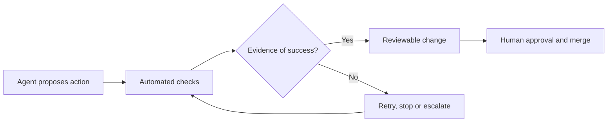

## The day in Software Engineering & Web Development

Fewer verified developments qualified for this edition, but both point to the same practical shift: coding agents are moving deeper into controlled engineering systems. GitHub has made agentic autofix generally available for code-scanning alerts. Copilot can inspect relevant files, propose a remediation, rerun CodeQL, iterate if necessary and open a draft pull request for human review. The feature is limited to eligible GitHub Enterprise Cloud customers and consumes AI Credits and Actions minutes. [GitHub’s announcement](https://github.blog/changelog/2026-10-15-agentic-autofix-for-code-scanning-alerts-general-availability) documents both the workflow and its access constraints.

Claude Code 2.1.301 addresses a different part of the same problem: making autonomous work safer to operate. The release adds a watchdog for unattended retries, richer OpenTelemetry fields distinguishing classifier decisions from permission rules, and fixes several cases involving misleading success reports, unsafe worktree deletion and failed searches being reported as empty results. [Anthropic’s release notes](https://github.com/anthropics/claude-code/releases/tag/v2.1.301) provide the implementation-level detail.

## The deeper pattern

The notable change is not simply that agents can write more code. It is that vendors are adding control loops around agent actions.

GitHub’s loop is security-oriented: detect a vulnerability, let an agent modify the repository, rerun a static-analysis check, then present a reviewable pull request. Claude Code’s loop is operational: constrain retries, expose decision metadata and make failures visible instead of silently converting them into apparent success. Together, these developments suggest that useful agentic development depends on verifiability at several stages:

The evidence supports a narrower conclusion than “agents can safely fix software”. GitHub demonstrates an integrated remediation workflow, but CodeQL confirming that an alert closes does not prove the patch is correct, complete or free of regressions. Claude Code’s release shows vendors recognising that unattended execution needs explicit limits and observability, yet telemetry only helps if teams collect it, retain it and know how to investigate it.

The common engineering requirement is therefore a richer definition of “done”: not merely generated code, but a traceable action, an independent check, a visible failure path and a human-controlled merge boundary.

## What to watch next

- Whether GitHub reports measurable results for agentic autofix: accepted pull requests, remediation time, revert rates or false closures.
- Whether Claude Code’s new telemetry becomes sufficient for organisations to audit agent permission decisions and classifier blocks in production workflows.
- Whether other coding-agent platforms add comparable stop conditions, failure semantics and validation gates rather than competing mainly on autonomous task completion.

## Editorial note

The main blind spot is outcome data. Both sources document product behaviour and safeguards, but neither establishes how often these workflows produce correct, secure patches in real repositories.
