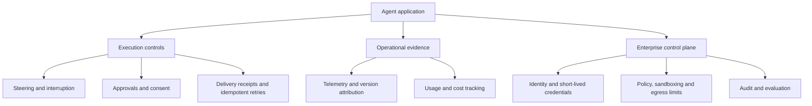

## The day in Software Engineering & Web Development

The strongest signal in this edition is that agent development is becoming more operational. Vercel’s AI SDK adds steering, interruption-related callbacks and version-aware telemetry, while Eve makes approvals, delivery receipts and session retries more explicit. These are not new model capabilities; they are controls for making agent behaviour observable, interruptible and recoverable in real applications ([AI SDK 7.0.154](https://github.com/vercel/ai/releases/tag/ai%407.0.154), [Eve 0.84.0](https://github.com/vercel/eve/releases/tag/eve%400.84.0)).

The same shift appears in enterprise tooling. OpenAI’s Java SDK adds delegation controls and prompt-cache lifetimes; IBM places agent identity, short-lived credentials and revocation alongside Vault and Terraform; SAP describes a governed platform spanning agent construction, interoperability, authentication, monitoring and auditing. On the web side, Algolia’s InstantSearch improves streamed conversational results, persistent conversation state and accessibility. Conduit’s release adds meaningful isolation and API-hardening measures, but operators should treat it as a security-oriented release requiring careful upgrade validation ([OpenAI Java 4.92.0](https://github.com/openai/openai-java/releases/tag/v4.92.0), [IBM](https://www.prnewswire.com/news-releases/ibm-introduces-identity-and-control-for-ai-agents-securing-frontier-intelligence-for-the-enterprise-302920156.html), [SAP](https://www.prnewswire.com/news-releases/sap-empowers-ai-developers-to-build-what-matters-and-turn-intent-into-autonomous-execution-302920376.html), [InstantSearch releases](https://github.com/algolia/instantsearch/releases), [Conduit 0.21.0](https://github.com/ConduitIO/conduit/releases/tag/v0.21.0)).

## The deeper pattern

The day’s developments point to a change in the engineering problem. Early agent integrations concentrated on calling a model and exposing tools. The newer work assumes that an agent may run for multiple steps, delegate to another agent, stream partial results, request approval, fail midway and retry. That makes the surrounding control system at least as important as the prompt.

A useful way to view the emerging stack is:

Vercel’s AI SDK addresses the execution and evidence layers. Steering lets an application intervene during generation or tool loops, while step-error and abort callbacks provide places to record or respond to failure. Version-aware telemetry matters because agent traces become difficult to interpret when behaviour changes underneath a running service. Without the emitting SDK version, an apparent regression may be indistinguishable from a model, prompt or infrastructure change.

Eve’s release makes the reliability boundary more explicit. Shared approval contracts and remembered per-tool decisions give applications a durable way to represent consent within a session. Delivery receipts separate streaming from final-result reads, and idempotency keys make retries safer. Those details are mundane by comparison with a model launch, but they address the exact failure modes that make autonomous workflows difficult to operate: duplicate side effects, lost acknowledgements, stale approvals and ambiguity about whether a task completed.

The OpenAI Java change fits the same pattern from a different angle. Delegation controls define how work is handed between agents or components; prompt-cache lifetimes define how long an optimisation remains valid. Together, they expose two policies that production systems previously had to approximate themselves: who may perform a subtask, and how long cached context should influence cost and execution behaviour. The evidence supports the existence of those controls, but not yet their effect on reliability or total spend in real deployments.

The enterprise announcements extend this control surface beyond the application runtime. IBM’s proposal to use Vault for short-lived agent credentials and revocation treats an agent as a workload that needs identity, not as a trusted script. Its accompanying claims about sandboxing, evaluation and cost tracking connect agent behaviour to familiar security and operations practices. SAP similarly describes a central gateway for authentication, routing, monitoring, usage tracking and auditing, alongside MCP and A2A interoperability. The important consequence is architectural: tool access, model routing and audit records are being pulled towards shared platform services.

That consolidation could reduce duplicated security work, but it also creates a new dependency on platform policy. A central gateway can enforce controls consistently; it can also become a choke point for availability, vendor coupling and incorrect permissions. The announcements establish product direction, not independent proof that these systems prevent unsafe actions. Teams should therefore distinguish “the platform records and governs an action” from “the action is safe”.

The web-development changes are a smaller but practical version of the same movement. InstantSearch’s persistent conversation identifiers allow a search interaction to continue as a stateful exchange rather than a sequence of unrelated queries. Streaming answer content changes the interface contract: components must handle partial output, cancellation and completion. The release also adds reply announcements and keyboard-oriented history navigation, evidence that conversational interfaces need accessibility behaviour designed into the component layer rather than added after the model integration.

Conduit provides the security counterweight. Connector dial guards, plugin-environment isolation, API-token authentication, CSRF protection and security headers show that data pipelines are being hardened at their network and web boundaries. But security fixes can introduce operational risk: a release that changes startup, authentication or egress behaviour needs staged rollout, pipeline tests and a rollback path. In agentic systems, the same principle applies more broadly: every new permission or retry mechanism should be tested for both the intended path and the repeated, interrupted path.

## What to watch next

1. Whether agent SDKs begin exposing standard, interoperable event schemas for steering, approvals, delivery, retries and tool outcomes. This would make cross-vendor observability and incident investigation materially easier.

2. Whether enterprise agent platforms publish concrete evaluation results showing reduced unauthorised tool use, credential exposure or duplicate side effects—not merely dashboards, audit logs and governance features.

3. Whether web frameworks and component libraries standardise interaction patterns for streamed answers: cancellation, resumability, keyboard navigation, screen-reader announcements and state restoration after reconnect.

## Editorial note

This edition is based on a concentrated set of vendor and project release materials, not independent production studies. The IBM and SAP items are announcements whose stated capabilities still need verification through documentation and deployments. FireMon’s supplied material was not included as a confirmed development because the accessible first-party page provided a publication date but no verifiable clock time and timezone for the triggering change.
