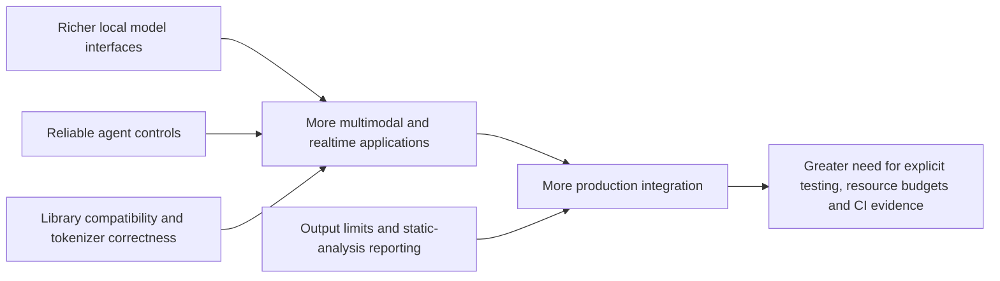

## The day in Software Engineering & Web Development

Fewer than ten verified developments qualified for this edition, so it is shorter by design. The strongest signal is that developer infrastructure is becoming more capable at the edges: `llama.cpp` 0.8.0 adds local multimodal and realtime audio serving, while GitHub Copilot CLI fixes model selection for long-context terminal sessions. Together, they improve the practical path from an experimental model to a usable developer-facing application. [llama.cpp release](https://github.com/ggml-org/llama.cpp/releases) [Copilot CLI 1.0.105](https://github.com/github/copilot-cli/releases/tag/v1.0.105)

The quieter releases are equally relevant to production engineering. Mistral Common 1.13.0 improves Python and tokenizer compatibility; Brotli 1.2.0 adds a caller-controlled decompression-output limit; and Cppcheck 2.16 adds SARIF output and new native-code checks. These changes do not promise dramatic capability gains, but they reduce friction and risk in the layers that determine whether software can be packaged, analysed and operated safely. [Mistral Common releases](https://github.com/mistralai/mistral-common/releases) [Brotli 1.2.0](https://github.com/google/brotli/releases/tag/v1.2.0) [Cppcheck releases](https://github.com/cppcheck-opensource/cppcheck/releases)

## The deeper pattern

The five releases describe a software stack moving in three connected directions: richer interfaces, more dependable control, and better integration with existing engineering systems.

At the application layer, `llama.cpp` 0.8.0 is a substantial expansion of what a local inference server can expose. The release supports Liquid AI’s LFM3 text, vision, audio and omni models, adds experimental streaming audio, and introduces `/v1/realtime` and `/tts` endpoints. It also adds deferred tools and `tool_reference` content parts. That matters because developers can now prototype voice, transcription and multimodal tool-using applications within a familiar local-serving stack, rather than assembling separate model runtimes for each modality. The evidence supports an API and integration change; it does not, by itself, establish that the resulting applications will match hosted realtime services in latency, reliability or quality. [llama.cpp release](https://github.com/ggml-org/llama.cpp/releases)

The Copilot CLI fix shows the other side of agent development: capability is only useful when users can select and control it reliably. Version 1.0.105 fixes selection of Copilot Fusion High or Max from `/model` in long-context sessions. That is a narrow change, but long-running terminal agents depend on predictable model choice. If a workflow silently falls back to a different model, developers cannot readily explain changes in task completion, latency or cost. The release therefore improves observability of the agent’s operating mode, even though it provides no evidence that either model is intrinsically better at coding. [Copilot CLI 1.0.105](https://github.com/github/copilot-cli/releases/tag/v1.0.105)

The supporting libraries show why agentic systems increasingly depend on ordinary ecosystem maintenance. Mistral Common 1.13.0 adds Python 3.15 support, improves offline tokenizer-download fallback, corrects cache-directory handling and rejects multiple tool results in tokenizer version 2. These are compatibility and boundary-condition changes, not model breakthroughs. Their significance is operational: tool-using model applications are assembled from Python packages, tokenisers, caches and message converters, so small inconsistencies can fail before a model performs any useful work. [Mistral Common releases](https://github.com/mistralai/mistral-common/releases)

Security is also becoming a matter of explicit resource governance rather than simply patching a vulnerable parser. Brotli 1.2.0 adds `Decompressor::can_accept_more_data` and an `output_buffer_limit` argument to `Decompressor::process`, allowing applications to limit unexpectedly large decompressed output. The important qualification is that this is an available control, not an automatic guarantee: applications still need to set sensible limits and handle rejection correctly. For web servers and services processing attacker-controlled compressed input, that makes memory and work budgets more visible at the API boundary. [Brotli 1.2.0](https://github.com/google/brotli/releases/tag/v1.2.0)

Cppcheck 2.16 completes the picture on the quality side. It adds checks for multidimensional `const` variables, nested const-pointer cases and deallocation use, while supporting SARIF output through `--output-format=sarif`. SARIF makes analysis results easier to consume in code-scanning and CI systems. The durable change is not that static analysis suddenly finds every defect; it is that findings can travel more cleanly into the same workflow used for builds, review and security gates. [Cppcheck releases](https://github.com/cppcheck-opensource/cppcheck/releases)

The relationship can be summarised simply:

The common theme is not “AI replaces software engineering”. It is that new model capabilities are entering established engineering surfaces: HTTP endpoints, CLIs, Python packages, compression libraries and CI reports. That makes integration quality and operational safeguards more important, not less. A realtime endpoint without measurable latency, an agent without dependable model selection, or a scanner without actionable CI output remains a demonstration rather than a dependable development tool.

## What to watch next

- Whether `llama.cpp`’s `/v1/realtime` and `/tts` interfaces move from experimental use towards documented, stable support, with published latency and concurrency evidence.

- Whether Copilot CLI releases add tests or diagnostics that expose the selected model and context state, rather than merely fixing individual selection failures.

- Whether Brotli consumers and CI platforms adopt the new output-limit API and SARIF support in practice, visible through integration patches, documented defaults or new security guidance.

## Editorial note

The main blind spot is that this edition relies on five project release pages rather than a broader set of independently reported deployments or benchmarks. The release notes establish what changed, but they do not show adoption, production reliability, comparative performance or the frequency of the problems being addressed.
